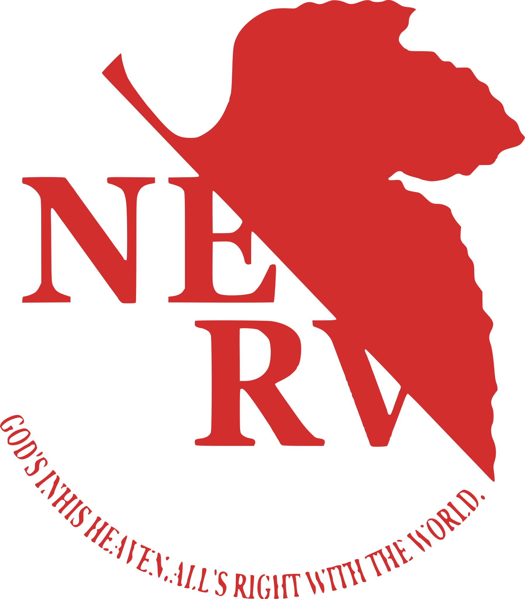
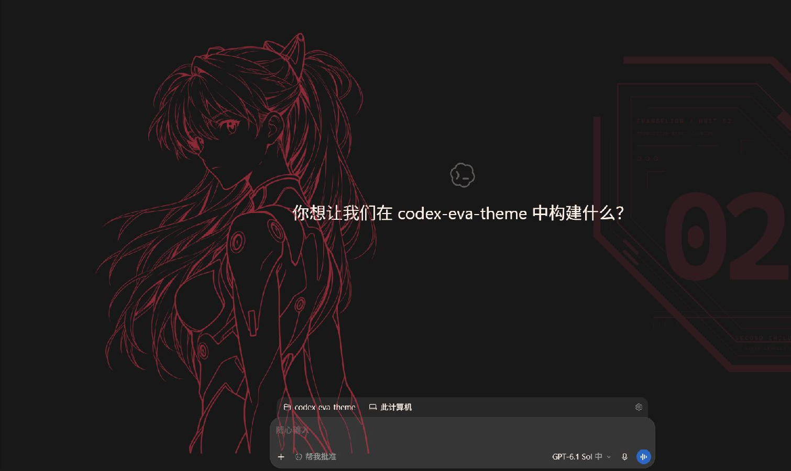
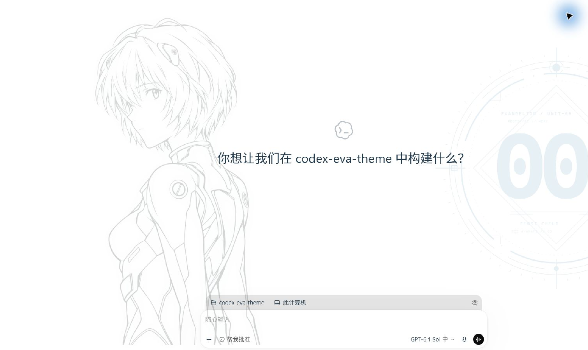
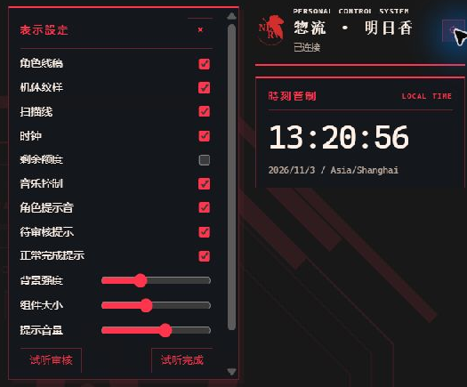

<div align="center">



# Codex EVA Theme

**在熟悉的 Codex 工作台，切换你的 EVA 驾驶员。**

深色明日香，浅色绫波丽。角色线稿、机体纹样与工作台仪表随外观切换，配合 Windows 媒体控制和任务提示音。

**v0.1.0-beta.1 · Windows 预览 · 完整下载包保持草稿**

[实图展示](#双驾驶员实图展示) · [快速上手](QUICKSTART.md) · [组件与个性化](#组件与个性化) · [发布状态](#当前状态) · [问题反馈](https://github.com/jingtll/codex-eva-theme/issues)

</div>

**本项目二次开发于 [seaison/dsh-plugin-eva-theme](https://github.com/seaison/dsh-plugin-eva-theme)，面向 Codex 移植与适配。** 感谢上游作者的主题设计与参考资源。上游服务于 DSH / DeepSeek Harness，本仓库提供 Codex 外观主题与独立 Windows 伴随程序；具体差异见[与上游的关系](#与上游的关系)。这是第三方同人项目，与 OpenAI、DSH 或 EVA 权利方没有官方关联。

## 双驾驶员，实图展示

切换 Codex 的深色／浅色模式，即可切换角色。人物线稿位于工作台左侧，机体纹样位于右侧，保留中间的输入和工作区域。

| **02 · 明日香 / ASUKA LANGLEY** | **00 · 绫波丽 / REI AYANAMI** |
| :---: | :---: |
| 深色 · 红色线稿、炭黑背景与 02 装甲纹样 | 浅色 · 灰色线稿、白色背景与冰蓝 00 圆环 |

<p align="center">
  <a href="docs/screenshots/codex-asuka-dark.png"></a>
  <a href="docs/screenshots/codex-rei-light.png"></a>
</p>

点击图片查看原尺寸。以上为 **2026-11-03 本项目在真实 Codex 客户端运行的截图**，裁剪为主工作区；不是上游截图或设计效果图。拍摄时背景强度为 0.17、组件大小为 1，临时隐藏个人额度与侧栏；仅作裁剪，未调整色彩或重绘界面。实际效果随客户端版本、窗口、缩放及设置而变化。[截图说明](docs/screenshots/README.md)

- **双角色工作台**：大幅角色线稿、独立机体装饰和角色配色，覆盖新建/已有聊天与设置页；图像等页面自动隐藏。
- **一次配置，点击启动**：使用 Codex EVA 快捷方式补启伴随程序、打开官方 Codex 并检查皮肤，不依赖开机常驻。
- **仪表与任务提醒**：查看可用额度窗口，按角色播放人工操作与正常完成提示音；功能可分别关闭。
- **按自己的习惯调节**：背景强度、组件大小、扫描线、音乐控制和音量即时调整并保存。

## 启动与日常体验

> 点击 Codex EVA → 核实伴随程序 → 打开官方 Codex → 等待工作台 → 检查皮肤

配置完成后，从 **Codex EVA** 快捷方式进入即可。若普通模式 Codex 已运行，启动器会提示你先保存并完全退出；它不会替你结束聊天。重复点击会复用伴随程序实例，原官方入口保留。

托盘菜单可暂停皮肤、打开显示设置或退出伴随程序。新客户端版本或资源指纹未经验证时，相关事件适配会停用，不能把打开窗口等同于全部功能可用。安装步骤见下方两种方式。

## 组件与个性化

点击右侧驾驶员面板的齿轮，或通过 EVA 托盘打开显示设置。常用选项可以独立开关，偏好保存在当前用户的 `%APPDATA%\CodexEva\settings.json`。

| 组件 | 使用体验 |
| --- | --- |
| **角色背景与装饰** | 人物、机体纹样和扫描线分别开关；可调整背景强度与组件大小。 |
| **时钟** | 显示本地时间、日期和时区，跟随驾驶员配色。 |
| **剩余额度** | 按可用窗口显示剩余比例与重置时间；缺失值保持未知，不换算成剩余 token 或当前聊天余额。 |
| **音乐控制** | 连接 Windows 系统媒体接口；有可用媒体来源时提供播放/暂停、上一首和下一首。 |
| **角色提示音** | 待人工操作与主会话正常完成提醒，可分别开关、试听和调整音量；不会代替用户批准操作。 |

<p align="center"><a href="docs/screenshots/codex-display-settings.png"></a></p>

上图为真实客户端设置面板裁剪。为避免公开个人使用状态，截图时关闭了剩余额度；未使用模拟额度填充画面。真实媒体、额度和提醒的完整验收仍列在发布待办中。

## 当前状态

截至 2026-11-03，`v0.1.0-beta.1` 已准备完整 Windows 测试包与 SHA-256 校验文件，GitHub Release **保持草稿，尚未公开下载**。素材公开再分发依据与干净 Windows 环境验收仍待完成，完整包暂不作为正式发行版提供。

当前测试基线位于 `chore/github-beta-release` 分支，包含工作台定位、深色线稿笔触与页面可见性修复；默认分支 `main` 尚未包含这批修复。下方源码试用命令明确使用测试分支。发布范围见 [测试版说明](docs/release/v0.1.0-beta.1.md)。

GitHub 自动生成的 `Source code (zip)` 是指定提交的源码快照，不等同于已通过安装验收的成品包。

## 两种使用方式

| 方式 | 能获得什么 | 运行条件 |
| --- | --- | --- |
| 外观主题 | 深浅配色、字体槽位和状态色；可从 Codex 外观设置恢复默认 | 支持相应外观导入功能的 Codex；使用分享串无需 Node.js |
| Windows 伴随程序 | 角色立绘、机体纹样、时钟、额度仪表、系统媒体控制与角色提示音 | Windows、官方 Codex MSIX 客户端及下文列出的运行环境 |

单独导入配色只改变外观主题；角色背景、仪表、媒体与提示音由伴随程序提供。

## 方式一：导入外观主题

1. 打开 [明日香深色分享串](share/share-asuka-dark.txt) 或 [绫波丽浅色分享串](share/share-rei-light.txt)，复制完整内容。
2. 在 Codex「设置 → 外观」中粘贴导入相应主题。
3. 切换深色／浅色模式查看配色；需要还原时，选择默认外观。

分享串已随仓库提供，直接使用无需安装依赖或运行构建命令。

也提供 [config.toml 配置片段](share/config.toml)。该 TOML 路径根据宿主设置键推导，**尚未完成视觉验收**；如选择手工合并，请先备份现有配置，避免与已有表重复。优先使用分享串导入。字段与限制见 [主题令牌映射](docs/theme-tokens.md)。

## 方式二：运行 Windows 伴随程序

### 环境要求

| 环境 | 要求 |
| --- | --- |
| 系统 | Windows 10/11；macOS、Linux 的完整伴随程序尚未支持 |
| Codex | 已安装并能正常使用的官方 MSIX 客户端；主应用执行别名可用 |
| Node.js | 22 或更高版本；可用 `node --version` 检查 |
| PowerShell | Windows PowerShell 5.1；本流程不使用 PowerShell 7 |
| 编译器 | Windows 自带的 .NET Framework 4.x C# 编译器，首次配置时生成启动器 |
| 安装位置 | 当前用户可写、准备长期保留的完整项目目录 |

项目没有需要通过 `npm install` 安装的第三方运行依赖。完整包未内置 Node.js；`CodexEvaLauncher.exe` 只是启动入口，依赖项目目录中的脚本、源码和素材，不能单独复制使用。

### 获取与首次配置

当前完整包保持草稿，维护者验收可使用源码测试分支。安装 Git 后运行：

```powershell
git clone --branch chore/github-beta-release https://github.com/jingtll/codex-eva-theme.git
cd codex-eva-theme
```

在项目根目录使用 Windows PowerShell 5.1 创建桌面快捷方式：

```powershell
powershell.exe -NoProfile -File .\companion\windows\shortcut.ps1
```

首次配置会从 `ClickLauncher.cs` 编译启动器。需要把快捷方式放在项目内时，可显式指定目录：

```powershell
powershell.exe -NoProfile -File .\companion\windows\shortcut.ps1 -ShortcutDirectory "$PWD\companion"
```

快捷方式位置由安装收据记录；变更位置前先移除原入口。不要在配置后移动项目目录，否则需要重新创建快捷方式。

## 最近改动

- **启动流程**：点击入口同时补启伴随程序与官方客户端，不再把登录自启作为日常使用前提。
- **工作台布局**：装饰跟随主工作区，深色人物保留红色及原线宽；设置页无需输入框也能保持皮肤。
- **发布准备**：完整测试包、逐文件清单、SHA-256 与中文使用说明已准备，公开发布仍等待素材授权核实和干净电脑验收。
- **展示文档**：补充本项目真实客户端的双角色与设置面板实图，并明确上游来源。

## 升级、暂停与卸载

<details>
<summary>展开升级与卸载步骤</summary>

临时停用可通过 EVA 托盘选择暂停；退出伴随程序会停止本次皮肤接入。

升级前从托盘退出伴随程序，在旧目录移除快捷方式，然后完整解压新包或准备新源码目录，再创建入口：

```powershell
powershell.exe -NoProfile -File .\companion\windows\shortcut.ps1 -Remove
```

仅移除快捷方式会保留偏好。不要覆盖正在运行的目录，也不要把旧目录的 `build/` 或本机安装收据复制到新版本。

完整卸载时，在旧项目根目录运行：

```powershell
powershell.exe -NoProfile -File .\companion\windows\desktop.ps1 -Action Uninstall
```

卸载会先退出伴随程序，清理偏好及与收据匹配的入口；用户自行修改过的快捷方式或启动项会保留。确认卸载完成后可删除项目目录。该流程不卸载官方 Codex，也不删除 Codex 会话、凭据与用户项目。

</details>

## 兼容性与排错

伴随程序通过本机 loopback 调试端点接入，保持官方安装包原样。已有客户端验证记录对应内部版本 `26.1027.30824`，**运行时以资源指纹而非版本号判断事件适配是否已验证**。客户端升级可能需要重新适配；未验证时会停用事件适配，额度和提醒等功能可能不可用。

只读诊断：

```powershell
node .\companion\src\diagnose.mjs
```

该命令检查安装、版本、指纹与本机调试入口，不启动或关闭 Codex。

| 现象或错误 | 处理方式 |
| --- | --- |
| 只变了配色，没有人物与仪表 | 分享串只提供配色；完整皮肤需要运行伴随程序 |
| NODE_NOT_FOUND | 安装 Node.js 22+，重新打开终端确认版本 |
| CODEX_RESTART_REQUIRED | 保存工作并完全退出普通模式 Codex，再点击 EVA 入口 |
| CODEX_ALIAS_UNAVAILABLE | 检查官方安装和 Windows 应用执行别名注册 |
| SHORTCUT_REFRESH_REQUIRED | 在旧目录移除原快捷方式后重新创建；不要覆盖用户修改过的入口 |
| 皮肤在图像等页面消失 | 当前设计如此；返回聊天工作台或设置页查看 |
| 额度未知、媒体不可用或没有提示音 | 检查客户端指纹、系统媒体来源与对应设置；这些能力尚需真实环境验收 |
| PowerShell 或安全软件阻止脚本 | 核对来源、校验值和完整错误后反馈；不要全局关闭防护或执行策略 |

反馈请使用 [本仓库 Issues](https://github.com/jingtll/codex-eva-theme/issues)，附系统、Node.js 和 Codex 版本、主题模式、复现步骤与完整错误。分享日志或截图前隐去账号、聊天内容、个人路径和其他敏感信息。上游 DSH 专属问题请前往 [上游仓库](https://github.com/seaison/dsh-plugin-eva-theme)。

## 开发与文档

[快速上手](QUICKSTART.md) · [伴随程序机制](companion/README.md) · [主题令牌](docs/theme-tokens.md) · [验证记录](docs/validation/2026-11-03-beta-release.md) · [素材来源](companion/NOTICE.md)

<details>
<summary>开发、主题构建与验证命令</summary>

开发和打包需要 Node.js 22+；Windows 专项与打包测试还需要上述系统环境。下列命令在源码仓库根目录运行。

```powershell
npm run build                       # 从 themes/ 生成 share/ 主题产物
npm test                            # 产物一致性、schema、对比度和分享串往返
npm test --prefix companion          # 伴随程序契约与 Windows 专项测试
npm run test:release                 # ZIP 解压、摘要、运行资源与启动器编译回归
```

修改配色时编辑 `themes/*.json`，再运行 `npm run build`；`share/` 是生成物，应与主题源数据一起提交。校验要求正文与背景对比度至少 7:1，其余受检颜色至少 3:1。

浏览器回归需预先启动独立 Chrome/Chromium 测试实例，将其本机调试 HTTP 端点写入 `EVA_BROWSER_ENDPOINT`，再运行：

```powershell
npm run test:browser --prefix companion
```

请使用独立浏览器资料与测试端口。真实 MSIX 入口专项通过 `npm run test:msix-entry --prefix companion` 显式执行，不包含在普通契约测试中。

2026-11-03 记录的结果：伴随程序 103 项通过、1 项符号链接权限跳过；浏览器回归 12 项通过；主题与打包检查通过。自动化检查不替代干净电脑安装、真实升级/卸载、Windows 重启、真实媒体与额度、桌宠兼容性及安全软件接受度验收。详见 [测试版验证记录](docs/validation/2026-11-03-beta-release.md) 与 [验收范围](docs/validation/acceptance.md)。

</details>

<details>
<summary>维护者：测试包构建与校验</summary>

维护者在干净的 Windows 源码工作区运行：

```powershell
npm run release:pack
```

产物位于 `dist/releases/<版本>/`：

- `codex-eva-theme-v<版本>-windows.zip`：完整目录、主题、运行源码、素材与中文说明。
- `SHA256SUMS.txt`：ZIP 的 SHA-256。
- 包内 `release-manifest.json`：源提交、源工作区状态、逐文件摘要及待确认事项。

构建只选取 Git 已跟踪的文件，新增文件须先加入 Git；已有输出目录会拒绝覆盖。可用 `npm run release:pack -- --output <新目录>` 指定新位置。上传前须确认清单的 `sourceTreeDirty` 为 `false`。

构建与发布回归命令依赖 Git 仓库，应在源码检出目录使用；解压运行包支持主题构建和校验，不承诺自我打包。下载包不包含 Node.js、预编译启动器、用户快捷方式、设置、安装收据、日志、缓存或本地参考项目。校验方法见 [快速上手](QUICKSTART.md)。

</details>

<details>
<summary>项目结构</summary>

```text
themes/                 主题源数据与驾驶员目录
share/                  可直接导入的分享串与 TOML 片段
tools/                  主题构建、校验与测试包工具
companion/
  src/                  发现、会话、事件、额度与生命周期
  client/               工作台皮肤与页面事件适配
  windows/              启动器、快捷方式、媒体桥与卸载
  assets/               人物、标志与角色提示音
  tests/                契约、浏览器与 Windows 专项回归
  NOTICE.md             素材来源、分发边界与摘要
docs/                   主题映射、设计决策、验证与发布说明
QUICKSTART.md           Windows 测试版使用说明
LICENSE                 本仓库代码许可
```

本地 `dsh-plugin-eva-theme/` 为未入库的上游参考副本，不是安装或运行依赖。

</details>

## 与上游的关系

本项目沿用上游的 EVA 双驾驶员视觉方向，并针对 Codex 的页面结构、启动入口、事件与 Windows 媒体能力重新适配。当前实现与上游独立维护，不保证功能或版本同步。

| 范围 | 本仓库的处理 |
| --- | --- |
| 双角色配色与装饰 | 适配 Codex 深浅模式、工作台布局、角色立绘与机体纹样 |
| 宿主接入 | 通过独立伴随程序连接本机调试端点，提供 Codex 页面皮肤与事件适配 |
| 日常启动 | 新增 Codex EVA 快捷方式，同时启动伴随程序和官方 Codex |
| 状态仪表 | 展示使用额度窗口的剩余比例与重置时间；数据缺失时保留未知状态 |
| 媒体与提醒 | 使用 Windows 系统媒体桥；提供人工操作与任务正常完成的角色提示音 |
| 上游其他功能 | 未迁移驾驶员认证开场、选择/装载动画、启动背景音乐、TPS 波形与计费金额估算 |

本仓库采用自己的源码和构建流程，无需另外下载本地参考项目目录。上游插件管理器的安装步骤不适用于本仓库。

## 致谢与许可

再次感谢 [seaison/dsh-plugin-eva-theme](https://github.com/seaison/dsh-plugin-eva-theme) 及其作者。本仓库的 Codex 适配建立在原项目的主题方向与参考资源之上；请保留原项目来源与适用的许可声明。

本仓库代码采用 [MIT License](LICENSE)。EVA 角色、品牌、图像与语音相关权利归相应权利人所有，代码许可不替代第三方素材授权。随包七项素材的来源与 SHA-256 见 [NOTICE](companion/NOTICE.md)；公开再分发依据核实完成前，完整测试包保持草稿。
